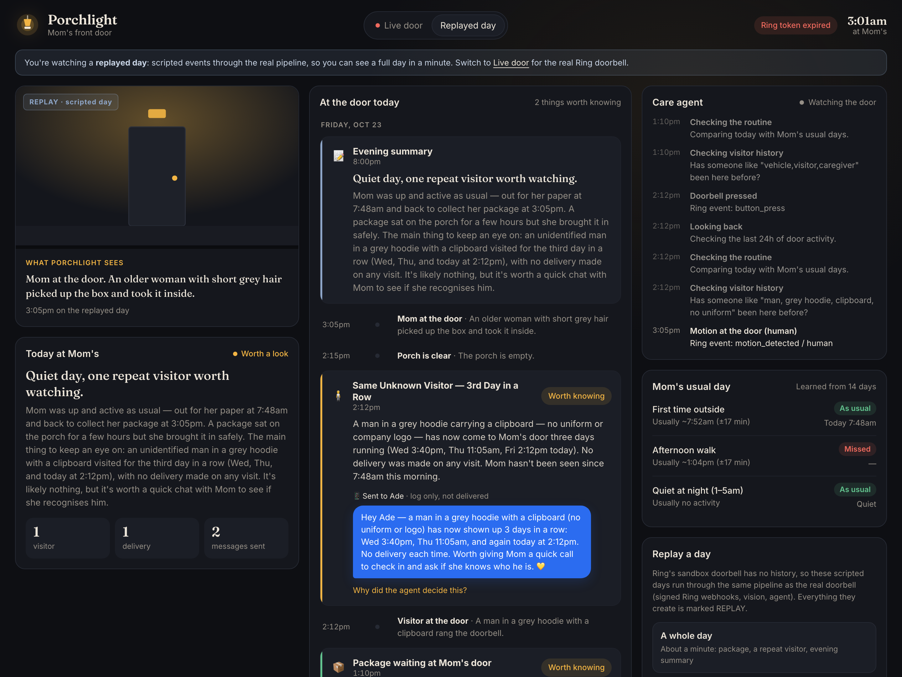
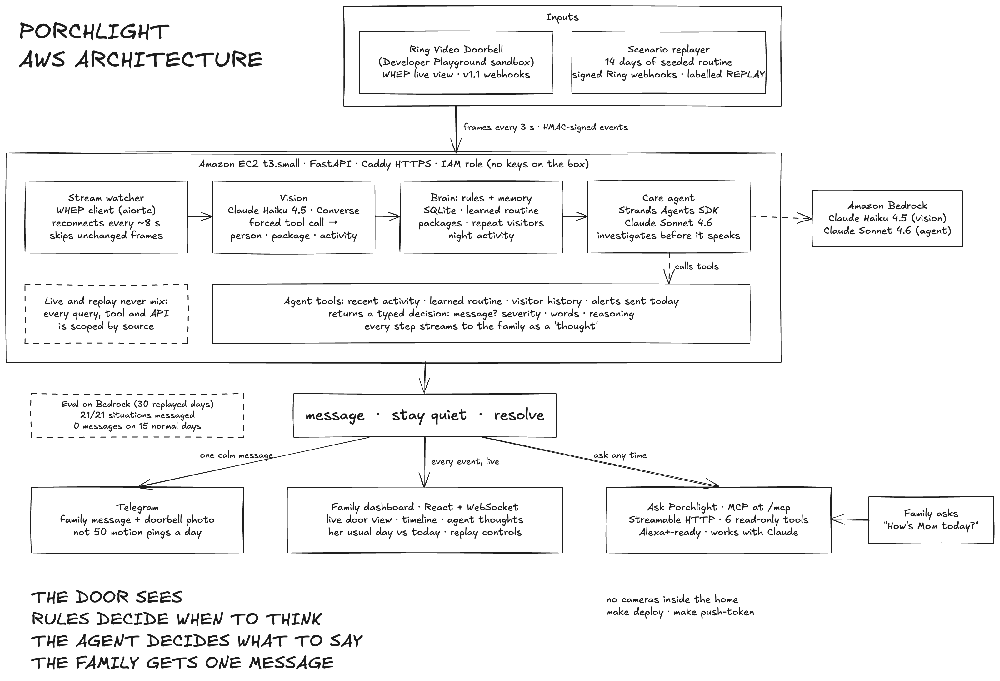

# Porchlight

**A care agent for your parent's front door.**

**[Try Porchlight](https://100-57-176-133.sslip.io/?view=replay)** · **[Demo video](#demo-video)** · [Architecture](#architecture) · [Ask Porchlight (MCP)](#ask-porchlight-mcp) · [Evaluation](eval/AGENT_EVAL.md) · [Friction log](docs/FRICTION_LOG.md)

## Table of contents

- [Project overview](#project-overview)
- [What Porchlight does](#what-porchlight-does)
- [A day at Mom's](#a-day-at-moms)
- [Architecture](#architecture)
- [External apps and services](#external-apps-and-services)
- [How we used the Ring API](#how-we-used-the-ring-api)
- [How we used Amazon Bedrock](#how-we-used-amazon-bedrock)
- [How we used the Strands Agents SDK](#how-we-used-the-strands-agents-sdk)
- [How we used AWS to host it](#how-we-used-aws-to-host-it)
- [Ask Porchlight (MCP)](#ask-porchlight-mcp)
- [Local setup](#local-setup)
- [Connect the integrations](#connect-the-integrations)
- [Reliability and evaluation](#reliability-and-evaluation)
- [Current limitations](#current-limitations)
- [Deployment](#deployment)
- [Demo video](#demo-video)
- [Open-source contribution](#open-source-contribution)
- [Repository contents](#repository-contents)
- [Troubleshooting](#troubleshooting)
- [Development tools and credits](#development-tools-and-credits)

## Project overview

Porchlight helps families **look after a parent who lives alone, using only the Ring doorbell at the front door**.

The front door is where a day's routine shows. She picks up the paper, she goes out for her walk, a package arrives, someone keeps coming by. A family that lives far away sees none of it. A daily phone call misses most of the day, and many parents won't accept cameras inside their home.

Porchlight watches the doorbell, learns what a normal day looks like for her, and speaks up only when something needs attention. Before it sends anything, a care agent checks her routine, recent activity, past visitors and what the family has already been told. The family gets **one calm, specific message instead of a stream of motion alerts**.

Built for the **[Build, Ship, Shape: Amazon Developer Hackathon](https://amazonappdev2026.devpost.com/)** in the **Ring track** (caretaking), with the **AWS Builder** and **Open Source** mini challenges. It runs on the Ring Developer sandbox doorbell, Amazon Bedrock and Amazon EC2.

The hosted dashboard needs no sign-in. The sandbox doorbell has no history, so the hosted dashboard opens on a **replayed day**: scripted events that run through the real pipeline and are clearly labelled. The **Live door** view shows the real Ring sandbox stream whenever a fresh Playground token is loaded.

## What Porchlight does

1. **Watches the front door.** It opens Ring live-view sessions, takes a frame every few seconds, and skips frames where nothing changed.
2. **Understands each frame.** Claude on Amazon Bedrock turns a frame into facts: is there a person, a package, a vehicle, what's happening, and what the visitor looks like.
3. **Learns her normal day.** From two weeks of door activity it learns when she usually first steps out, her afternoon walk, and that nights are quiet.
4. **Notices what matters.** Rules flag a package left outside, a package taken by someone else, the same stranger coming back, a missed morning routine, and activity at the door between 1am and 5am.
5. **Investigates before it speaks.** A Strands agent looks at the evidence with its tools, then decides whether to message the family, how urgent it is, and exactly what to say.
6. **Keeps the family in the loop.** A Telegram message with the doorbell photo, a live dashboard with the agent's reasoning, an evening summary, and an MCP server so any assistant can answer *"How's Mom today?"*.

Porchlight never sees inside the home. It doesn't identify people by face, call emergency services, or unlock doors.

## A day at Mom's

The **A whole day** replay follows one Friday at Mom's front door. The routine she followed for the previous 14 days is seeded. The messages below are what the agent on Bedrock actually wrote in one run.

| Time | At the door | What Porchlight did |
| --- | --- | --- |
| 7:48am | Mom picks up the newspaper | Noted: she was out at her usual time (usually ~7:52am) |
| 10:06am | A courier leaves a box on the step | Started tracking the package |
| 1:10pm | The box is still outside | **Messaged the family:** *"A package has been on Mom's step since 10:06am. She was out at her usual time (7:48am) but hasn't been to the door since…"* |
| 2:12pm | A man in a grey hoodie with a clipboard rings the bell | Agent checked the visitor history and found Wednesday 3:40pm and Thursday 11:05am. **Messaged the family:** *"…has now shown up 3 days in a row… No delivery each time. Worth giving Mom a quick call to check in and ask if she knows who he is."* |
| 3:05pm | Mom brings the box inside | Marked the package alert **resolved** |
| 8:00pm | | **Evening summary:** *"Quiet day, one repeat visitor worth watching."* |

Two messages in a day, each with the evidence behind it. On the five kinds of normal day in our evaluation, Porchlight sent **no messages at all**.

## Architecture

[](docs/architecture/porchlight-architecture.png)

**[View full-size PNG](docs/architecture/porchlight-architecture.png) · [SVG](docs/architecture/porchlight-architecture.svg) · [Editable Excalidraw](docs/architecture/porchlight-architecture.excalidraw)**

Everything runs in one FastAPI service on an EC2 instance:

- The **stream watcher** pulls frames from the Ring doorbell over WHEP. **Vision** (Claude Haiku 4.5) turns each changed frame into structured facts.
- The **brain** stores them in SQLite, learns the routine, and applies cheap deterministic rules. Only when a rule fires does the **care agent** (Strands + Claude Sonnet 4.6) investigate with its tools and decide.
- Every step reaches the family over Telegram, the dashboard's WebSocket and the MCP server.

**Rules decide when to think. The agent decides what to say, and whether to say it.**

Real Ring webhooks and the replayer's synthetic ones go through the **same signed handler**. Live and replayed data never mix: every query, agent tool, summary and API response is scoped to one source.

## External apps and services

| Technology | Role in Porchlight |
| --- | --- |
| **Ring Partner API** (Amazon Vision API) | WHEP live view, device discovery, event history, v1.1 webhooks with HMAC-SHA256 signatures |
| **Ring Developer Playground** | Sandbox doorbell; the Package / Vehicle / Motion scenes drive the live stream |
| **Amazon Bedrock** | Claude Haiku 4.5 for frame understanding; Claude Sonnet 4.6 for the care agent and evening summary |
| **Strands Agents SDK** | The care agent: tools, the agent loop, typed structured output |
| **Amazon EC2 + AWS IAM** | Hosting; an instance role gives Bedrock access with no stored keys |
| **MCP Python SDK** | *Ask Porchlight*: an MCP server over Streamable HTTP |
| **Telegram Bot API** | Family messages with the doorbell photo |
| **FastAPI, aiortc, SQLite** | API and WebSocket, the WebRTC client, memory |
| **React, Vite, TypeScript** | The family dashboard |
| **Caddy, systemd** | HTTPS and process supervision on the server |

## How we used the Ring API

- **Live view over WHEP.** [`watcher.py`](backend/porchlight/watcher.py) sends a recvonly SDP offer to `POST /v1/devices/{id}/media/streaming/whep/sessions` and receives video with `aiortc`. It always `DELETE`s the session when done.
  - The sandbox ends each session after about 8 seconds, so the watcher reconnects in a loop.
  - It samples a frame every 3 s and skips frames that haven't changed (a 64×36 greyscale diff), plus a forced frame every 30 s.
  - An expired token is reported to the dashboard, which shows a countdown.
- **Devices and history.** [`ring.py`](backend/porchlight/ring.py) discovers the doorbell with `GET /v1/devices?include=status,capabilities,location,configurations` and reads `GET /v1/history/devices/{id}/events`. It reads the Playground token's expiry from its JWT.
- **Webhooks.** [`webhooks.py`](backend/porchlight/webhooks.py) parses the v1.1 payloads (`motion_detected` with `sub_type`, `button_press`) and verifies `X-Signature: sha256=<hex>` over the raw body with a constant-time compare. Delivery is idempotent on `request_id`.
- **Replay through the real path.** The sandbox has one doorbell and no history. So [`replayer.py`](backend/porchlight/replayer.py) seeds 14 days of believable routine, then plays scripted days on a compressed clock, building Ring-format webhooks, signing them with our HMAC key and sending them through the **same handler** as real ones.

We hit real limits in the sandbox: no recordings (media download returns 416), 30-minute tokens, about 8-second streams, and no webhooks from Playground actions. Each one is written up with a workaround and a suggestion in the [friction log](docs/FRICTION_LOG.md).

## How we used Amazon Bedrock

- **Vision: Claude Haiku 4.5** (`us.anthropic.claude-haiku-4-5-20251001-v1:0`) through the **Converse API** with a **forced tool call** (`toolChoice`).
  - Each changed frame becomes a typed `Observation`: description, person, package, vehicle, activity (one of 11), a comma-separated visitor signature, and a concern.
  - It takes about 1.3 s per frame. See [`vision.py`](backend/porchlight/vision.py).
- **Agent and summaries: Claude Sonnet 4.6** (`us.anthropic.claude-sonnet-4-6`) through Strands, at temperature 0.2.
- **US cross-region inference profiles** in us-east-1.
- **On EC2,** the instance role's inline policy only allows `bedrock:InvokeModel*` and `Converse*` on Anthropic models.

The model describes. Rules decide when something might matter. The agent decides what the family hears.

## How we used the Strands Agents SDK

[`agent.py`](backend/porchlight/agent.py) defines the **CareAgent**: `Agent(model=BedrockModel(...), tools=[...])` with four `@tool` functions over Porchlight's memory.

| Tool | What the agent learns |
| --- | --- |
| `get_recent_activity(hours)` | Everything the doorbell saw recently |
| `get_routine_baseline()` | Her learned routine, today so far, when she was last seen |
| `get_visitor_history(signature)` | Earlier visits by someone who looks the same |
| `get_alerts_sent_today()` | What the family has already been told, to avoid repeating it |

- **Typed decisions.** `invoke_async(..., structured_output_model=AlertDecision)` returns a typed decision: `send_alert`, `severity` (info / notice / urgent), a card title and summary, the **family message**, and the **reasoning**. The dashboard shows that reasoning under *"Why did the agent decide this?"*. The evening summary uses a second structured model, `DaySummary`.
- **Visible thinking.** Every tool call is published as an `agent_thought`, so the family watches the agent think in the **Care agent** panel.
- **Honest when it doesn't know.** With no history on the live doorbell, `get_routine_baseline` says so, and the agent's message says *"We don't have enough history yet to know if that's normal for her."*
- **Fallback.** If Bedrock fails or takes longer than 60 s, Porchlight falls back to a template message, so an alert is never lost.

## How we used AWS to host it

- **Amazon EC2:** a t3.small running Ubuntu 24.04 in us-east-1, with an Elastic IP.
- **AWS IAM:** the instance profile `porchlight-ec2` grants Bedrock invoke on Anthropic models, plus SSM. **No AWS keys on the server.** The same role ran the 30-day evaluation.
- **HTTPS and process supervision:** Caddy provides HTTPS on a free `sslip.io` hostname, so Ring can reach the webhook endpoint. systemd restarts the service on failure.
- **Security group:** ports 80 and 443 are open; SSH is only open to the developer's IP.

## Ask Porchlight (MCP)

Families don't want another app to check. So Porchlight is also an **MCP server** at `/mcp`:

- Streamable HTTP, built with the official MCP Python SDK (spec 2025-11-25 and later). That's the standard Alexa+ integrations are built on.
- Any MCP-capable assistant can answer questions from what the doorbell saw.

| Tool | Answers |
| --- | --- |
| `how_is_parent_doing` | *"How's Mom today?"*: the day's summary, anything still open, when she was last seen, routine changes |
| `open_concerns` | *"Anything I should worry about?"*: what was flagged, what the family was told, what's resolved |
| `visitors_this_week` | *"Has that clipboard guy been back?"*: visitors grouped by appearance, with every visit |
| `usual_routine` | Her learned routine vs today |
| `recent_activity` | The last N hours at the door |
| `front_door_now` | What the Ring doorbell sees right now |

All tools are read-only and annotated as such. Answers are short sentences that read well and sound natural spoken, and they always say when they come from the replayed day. Set `MCP_TOKEN` to require `Authorization: Bearer <token>`.

```bash
# Claude Code
claude mcp add --transport http porchlight https://100-57-176-133.sslip.io/mcp
# Claude app: Settings → Connectors → Add custom connector → https://100-57-176-133.sslip.io/mcp
```

See [`mcp_server.py`](backend/porchlight/mcp_server.py) and its [test](backend/tests/test_mcp.py), which talks to it through a real MCP client.

## Local setup

Requires **Python 3.11+**, **Node 18+**, **make** and **curl**.

```sh
git clone https://github.com/Pavilion-devs/porchlight.git
cd porchlight
make setup            # .venv, backend deps, dashboard build, .env from the example
make run-offline      # no Ring, no AWS: http://localhost:8000
```

In a second terminal, or with the dashboard's **Replay a day** buttons:

```sh
make demo                            # a full day in about a minute
make demo SCENARIO=routine_missed    # or: package, repeat_visitor, night_activity
```

Offline mode runs the replayed days with template messages instead of the agent. For the live doorbell and the real agent, connect the integrations below, then run `make run`. Run `make` to see every command.

## Connect the integrations

Keep credentials in `.env`. It's in `.gitignore`, and [`.env.example`](.env.example) lists every setting.

| Setting | Purpose |
| --- | --- |
| `HMAC_SIGNATURE_KEY` (and `CLIENT_ID`, `CLIENT_SECRET`) | From the Ring Developer Console → your app. Used to verify webhooks |
| `OAUTH_TOKEN` | Ring Developer Console → **Playground** → Generate token. It lasts 30 minutes, is re-read on every request, and needs no restart |
| AWS credentials | Not in `.env`: run `aws login` or `aws configure`. Enable **Claude Haiku 4.5** and **Claude Sonnet 4.6** in Bedrock (us-east-1) |
| `TELEGRAM_BOT_TOKEN`, `TELEGRAM_CHAT_ID` | Optional. Create a bot with @BotFather, message it, then `make telegram` fills in the chat ID and sends a test message |
| `PARENT_NAME`, `FAMILY_NAME`, `TIMEZONE` | Who the messages are about and for |
| `PACKAGE_ALERT_MINUTES` | Default 180. Use 2 for a live demo |
| `MCP_TOKEN` | Optional bearer token for `/mcp` |

```sh
make check            # checks Ring, Bedrock and Telegram, and says how to fix what's missing (never prints secrets)
```

In the Ring Playground, click **Package**, **Vehicle** or **Motion** to choose what the sandbox doorbell sees.

## Reliability and evaluation

```sh
make test             # 18 tests; no AWS or Ring calls
```

The tests cover:

- package tracking (including a missed frame), package taken, routine missed, night activity, and repeat versus new visitors
- webhook signatures and the v1.1 payload format
- **every replay scenario end to end**
- a regression test that **live decisions never use replayed history**, a bug we caught on the real stream
- the MCP server, through a real MCP client

**Agent evaluation** ([`eval/AGENT_EVAL.md`](eval/AGENT_EVAL.md)): 30 replayed days on Bedrock, run on our EC2 instance.

| | Result |
| --- | --- |
| Situations that should reach the family | **21 / 21 messaged** |
| Normal days (5 kinds × 3 runs) | **0 messages** |
| Same decision on every run | 9 / 10 cases |
| Fell back to template messages | 0 |

Two caveats:

- The zero false alarms come from the rules layer: on normal days nothing was escalated, so the agent wasn't asked. That's by design, but it isn't a test of the agent's own restraint.
- These are scripted days, not a broad real-world accuracy benchmark.

A first evaluation pass ([`eval/RESULTS.md`](eval/RESULTS.md)) found a Windows-only time-formatting crash, which is now fixed.

## Current limitations

- **Sandbox only.** One Playground doorbell, no recordings, 30-minute tokens, about 8-second streams, and no webhooks from Playground actions. Real staging users need a US Ring device and a Ring Protection plan.
- **History is replayed.** The 14-day routine is seeded and clearly labelled REPLAY. On the live doorbell, Porchlight says it hasn't learned her routine yet.
- **One parent, one door, one family chat.** There are no accounts, and the dashboard is public. Set `MCP_TOKEN` to protect the MCP server.
- **Visitor matching is coarse.** It compares described traits like "grey hoodie" and "clipboard". It never recognises faces, by design.
- **The routine model is simple.** It uses a median time with a spread window, and doesn't yet separate weekdays from weekends.
- **Vision accuracy is spot-checked, not benchmarked.** It was checked on the sandbox clips only.
- **Ring sensors and Chime aren't used.** The sandbox has neither.

## Deployment

**Live: [100-57-176-133.sslip.io](https://100-57-176-133.sslip.io/?view=replay)** (dashboard) · **[/mcp](https://100-57-176-133.sslip.io/mcp)** (MCP server)

```sh
make deploy           # build the dashboard, rsync code + .env, install, restart (~1 min)
make push-token       # send a fresh Ring Playground token to the server
```

The scripts in [`deploy/`](deploy/) default to our instance. Set `DEPLOY_HOST`, `DEPLOY_KEY` and `DEPLOY_SG` to deploy your own.

## Demo video

**Demo video:** link added at submission (under 3 minutes).

The video opens on the family's phone, then follows the product:

1. **The real Ring sandbox stream:** a package is spotted, the agent investigates, and the family gets a message.
2. **A full replayed day:** a repeat visitor, "Why did the agent decide this?", and the evening summary.
3. **Ask Porchlight:** asking an assistant *"How's Mom doing today?"*.

The script and shot list are in [`docs/demo-video.md`](docs/demo-video.md).

## Open-source contribution

**[AmazonAppDev/ring-api-helloworld#48](https://github.com/AmazonAppDev/ring-api-helloworld/pull/48)** adds `scripts/describe_frame.py` to Amazon's official Ring API sample.

- **What it does:** sends a Ring camera frame to Claude on Amazon Bedrock and gets back structured JSON (person, package, vehicle, activity, concern) using a forced tool call.
- **Why it matters:** the sample shows how to get video out of Ring, but not how to understand it. This is the smallest working bridge from a Ring frame to an AI decision, and it's the same technique Porchlight's vision step uses.

Porchlight itself is MIT-licensed.

## Repository contents

- `backend/porchlight/`:
  - `watcher.py`: WHEP stream watcher
  - `ring.py`: Ring API client
  - `vision.py`: Bedrock vision
  - `brain.py`: rules and state
  - `routine.py`: routine learning and visitor matching
  - `agent.py`: Strands care agent
  - `webhooks.py`: signing and verification
  - `replayer.py`: scenario replayer
  - `mcp_server.py`: Ask Porchlight
  - `alerts.py`: Telegram
  - `store.py`: SQLite
  - `app.py`: FastAPI, REST, WebSocket and `/mcp`
- `backend/tests/`: rules, webhooks, scenarios, source separation and the MCP server.
- `dashboard/`: the React + Vite family dashboard, served by the backend at `/` ([README](dashboard/README.md)).
- `shared/`: the backend–dashboard [contract](shared/CONTRACT.md), [TypeScript types](shared/types.ts) and [mock data](shared/mock/) with real sandbox frames.
- `eval/`: the [agent evaluation](eval/AGENT_EVAL.md), its raw results, and the first testing pass.
- `deploy/`: EC2 deployment, the systemd unit and the token push.
- `scripts/`: `doctor.py` (`make check`) and `telegram_setup.py` (`make telegram`).
- `spikes/`: the first experiments that proved the Ring stream and Bedrock vision.
- `docs/`:
  - [architecture](docs/architecture/)
  - [friction log](docs/FRICTION_LOG.md)
  - [Devpost submission text](docs/SUBMISSION.md)
  - [demo script](docs/demo-video.md)
  - [build plan](docs/plan.md)
  - [evaluation brief](docs/onboarding-eval.md)

Local credentials, the SQLite database and captured frames are excluded from the repository.

## Troubleshooting

| You see | Fix |
| --- | --- |
| *Ring token expired* on the dashboard | Playground tokens last 30 min. Generate a new one, save it in `.env` (and run `make push-token` for the server) |
| The stream reconnects every ~8 s | Expected: the sandbox ends each live session after about 8 s |
| `AccessDeniedException` from Bedrock | Enable the model in the Bedrock console, or set `VISION_MODEL` / `AGENT_MODEL` to one you can use |
| `MissingDependencyException` with `aws login` | Run `make setup` again (it installs `botocore[crt]`) |
| Messages only appear in the log | Telegram isn't configured. See `make telegram` |
| `Address already in use` | Something is already on port 8000. Stop it, or run `make run PORT=8001` |

## Development tools and credits

- **Development:** built with Claude Code. The architecture diagram was drawn in Excalidraw.
- **Footage:** the sandbox footage is the Ring Developer Playground's ([clip credits](shared/mock/README.md)).
- **Our team:**
  - Ola: product and backend
  - the evaluation teammate: testing, including the Windows bug
  - Claude Code: pair-programmer

MIT licensed. See [LICENSE](LICENSE).
